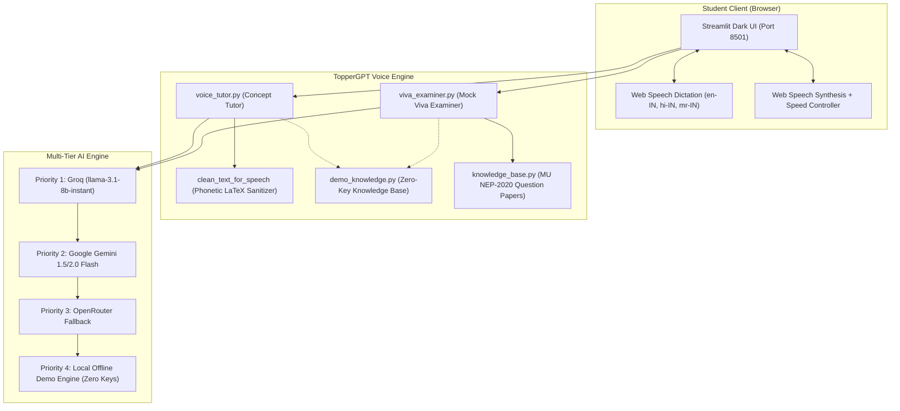

# 🎓 TopperGPT — Voice AI Academic Tutor & Mock Viva Examiner
### *Wispr Flow × Scaler Hackathon Edition*

[](https://www.python.org/)
[](https://streamlit.io/)
[](https://www.docker.com/)
[](LICENSE)
[](#-zero-key-academic-demo-mode)

TopperGPT is a voice-first academic workspace and oral exam simulation engine built exclusively for **Mumbai University (MU) Engineering students** under the C-Scheme (NEP-2020) curriculum.

Designed for the **Wispr Flow × Scaler Hackathon**, it transforms technical doubt clearing and oral examination prep into a natural, spoken dialogue with trilingual speech recognition, phonetic mathematical equation smoothing, and oral viva assessment.

---

## 🌟 Key Features

### 1. 🎙️ Voice Concept Tutor (`voice_tutor.py`)
- **Trilingual Speech Recognition**: Speak technical doubts naturally in **English (`en-IN`)**, **Hindi (`hi-IN`)**, or **Marathi (`mr-IN`)** using browser-native Web Speech recognition.
- **Interim Preview & Editable Confirmation**: Real-time interim transcript preview with an editable review box so students can correct variable names or notation before submitting.
- **Phonetic LaTeX Formula Smoothing (`clean_text_for_speech`)**: Automatically converts complex mathematical symbols and LaTeX code into natural spoken English so text-to-speech engines never awkwardly recite code tokens:
  - $\Delta = 2\mu t \cos(r) + \frac{\lambda}{2} \longrightarrow$ *"delta equals 2 micro t cos r plus lambda over 2"*
  - $\sqrt{x} \longrightarrow$ *"square root of x"*
  - $\Omega \longrightarrow$ *"ohms"*
- **Interactive Audio Player with Speed Control**: Listen to derivations at custom speeds ($0.9\times$ Relaxed, $1.0\times$ Normal, $1.2\times$ Exam Revision, $1.4\times$ Rapid Cram) with Play, Pause, Resume, and Stop controls.
- **Spoken Hinglish Toggle**: Instant one-click translation explaining derivations in conversational Roman Hindi + English.
- **Dual Fallbacks**: Native Streamlit audio recorder and manual keyboard typing ensure accessibility in noisy rooms or quiet libraries.

### 2. 🎯 Voice Mock Viva Voce Examiner (`viva_examiner.py`)
- **Real Mumbai University Exam Questions**: Powered by genuine university question papers from `knowledge_base.py` across:
  - 🔬 Applied Physics
  - 🌳 Data Structures
  - ⚡ Basic Electrical & Electronics
  - 🧪 Applied Chemistry
  - 📐 Applied Mathematics 1
  - ⚙️ Engineering Mechanics
- **1-on-1 Oral Viva Loop**: Asks one question at a time. The external examiner speaks the question aloud using audio playback.
- **Rigorous 5-Mark Assessment Rubric**:
  - **Numerical Score**: Scored strictly out of 5 marks.
  - **Visual Keyword Analysis**: Identified concepts render as **green chips**; missing syllabus keywords render as **red/amber chips**.
  - **Examiner Verdict**: Constructive technical feedback on depth and accuracy.
  - **Topper's Model Answer**: Full 5-mark university answer with spoken audio playback.
  - **Examiner Cross-Trap Alert**: Highlights sneaky traps external examiners use to deduct marks.
  - **Follow-up Cross-Question**: Simulates realistic viva cross-examination.

### 3. ⚡ Zero-Key Academic Demo Mode (`demo_knowledge.py`)
- **Guaranteed Hackathon Resilience**: Evaluators and hackathon judges can launch and test the application **without configuring any external API keys**.
- Automatically provides verified university derivations for core syllabus topics (Newton's Rings, BJT Voltage Divider Biasing, AVL Tree Double Rotations, He-Ne Gas Lasers, Maxwell's Equations).
- Includes a one-click toggle in Viva Voce to force offline demo evaluation.

---

## 🛠️ Architecture & Tech Stack



- **Frontend & App Framework**: [Streamlit](https://streamlit.io/) 1.52+ (Python)
- **Voice Dictation**: Web Speech API (`webkitSpeechRecognition`) supporting `en-IN`, `hi-IN`, `mr-IN`
- **Voice Playback**: Web Speech Synthesis with dynamic pitch, rate, and voice profile selection
- **Document & Math Rendering**: KaTeX math formatting ($...$ and $$...$$)
- **Containerization**: Docker & Docker Compose (Python 3.11-slim)
- **PDF Generation**: `fpdf2` with custom academic watermarking and typography
- **Database & Auth (Optional)**: [Supabase](https://supabase.com/) Python Client

---

## 🚀 Quick Start Guide

### Prerequisites
- Python 3.11, 3.12, or 3.13 installed
- Chrome, Edge, or Safari browser (for Web Speech API voice support)
- Docker & Docker Compose *(optional, for containerized execution)*

---

### Method A: Local Setup (Recommended)

1. **Clone the repository and checkout the hackathon branch**:
   ```bash
   git clone https://github.com/696900/TopperGPT-Final.git
   cd TopperGPT-Final
   git checkout hackathon/wispr-voice-tutor
   ```

2. **Create and activate a virtual environment**:
   ```bash
   # Windows (PowerShell)
   python -m venv .venv
   .venv\Scripts\Activate.ps1

   # Linux / macOS
   python3 -m venv .venv
   source .venv/bin/activate
   ```

3. **Install dependencies**:
   ```bash
   pip install --upgrade pip
   pip install -r requirements.txt
   ```

4. **Launch the application**:
   ```bash
   streamlit run APP.py
   ```
   Open your browser to **`http://localhost:8501`**.

---

### Method B: Docker Setup (1-Command Launch)

Build and start the container with zero configuration:
```bash
docker compose up --build
```
Open **`http://localhost:8501`** in your browser.

To stop the container:
```bash
docker compose down
```

---

## 🔑 Environment Configuration (Optional)

**All API keys are completely optional.** TopperGPT automatically defaults to Zero-Key Academic Demo Mode if no keys are provided.

To enable live, dynamic multi-turn AI generation:
1. Copy the sample environment file:
   ```bash
   cp .env.example .env
   ```
2. Add your keys in `.env`:
   ```ini
   GROQ_API_KEY=gsk_...
   GEMINI_API_KEY=AIza...
   OPENROUTER_API_KEY=sk-or-v1-...
   ```

---

## 🧪 Testing the Voice Features (Hackathon Jury Guide)

1. **Accessing the Workspace**:
   - Open `http://localhost:8501`.
   - Click **Login** &rarr; **🚀 CONTINUE AS GUEST STUDENT** &rarr; Enter your name &rarr; **ENTER WORKSPACE 🚀**.

2. **Testing Voice Concept Tutor**:
   - In the sidebar, select **`🎙️ Voice Tutor`**.
   - **Voice Input**: Under `🎙️ Speak Your Doubt (Mic)`, select your language (**English**, **Hindi**, or **Marathi**) and click **🎙️ Start Speaking**.
   - **Quick Demo**: Click any starter chip (e.g., **🔬 Newton's Rings & RI**).
   - Listen to the explanation using **▶ Play Spoken Answer** with speed controls.
   - Click **🗣️ Listen in Hinglish** for spoken Hindi + English explanations.

3. **Testing Mock Viva Voce**:
   - In the sidebar, select **`🎯 Mock Viva Voce`**.
   - Choose a subject (e.g., **Applied Physics** or **Data Structures**).
   - Listen to the examiner's spoken question via the audio player.
   - Speak or type an answer.
   - Review your **Score out of 5**, **Identified Keywords (Green)**, **Missing Concepts (Red)**, **Topper's Model Answer**, and **Examiner Trap Alerts**.

4. **Running the Automated Test Suite**:
   ```bash
   python tests/test_voice_viva.py
   ```

---

## 📁 Repository Structure

```text
TopperGPT-Final/
├── APP.py                      # Main Streamlit application and routing entry point
├── voice_tutor.py              # Voice Concept Tutor, Speech dictation & Voice Player
├── viva_examiner.py            # Mock Viva Voce oral exam loop & 5-mark rubric
├── demo_knowledge.py           # Zero-Key Demo engine and offline knowledge bank
├── knowledge_base.py           # Authentic Mumbai University PYQ papers (2024-2025)
├── landing_page.py             # Landing page UI and theme toggles
├── legal_content.py            # Terms of Service, Privacy Policy & Cookie Center
├── requirements.txt            # Python dependencies
├── Dockerfile                  # Production Docker container configuration
├── docker-compose.yml          # 1-command Docker Compose orchestration
├── .dockerignore               # Docker build context exclusions
├── .env.example                # Sample environment variables template
├── .gitignore                  # Git secret prevention and ignore rules
├── tests/
│   └── test_voice_viva.py      # Automated regression test suite
└── components/                 # Supporting UI components and Smart Notes module
```

---

## ⚖️ License & Credits

- Developed for the **Wispr Flow × Scaler Hackathon** (November 2026).
- Based on Mumbai University NEP-2020 Engineering Curriculum standards.
- Distributed under the [MIT License](LICENSE).
